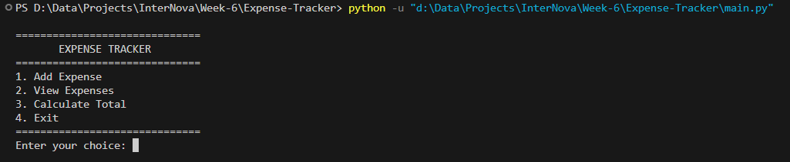
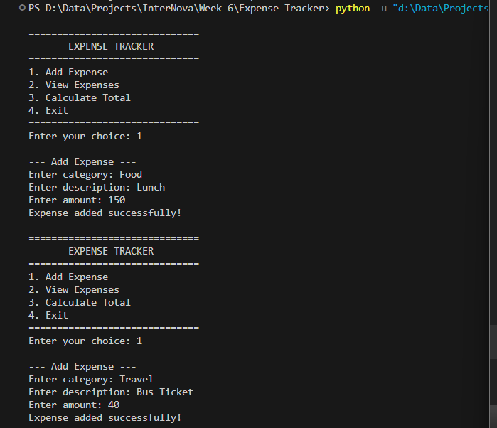
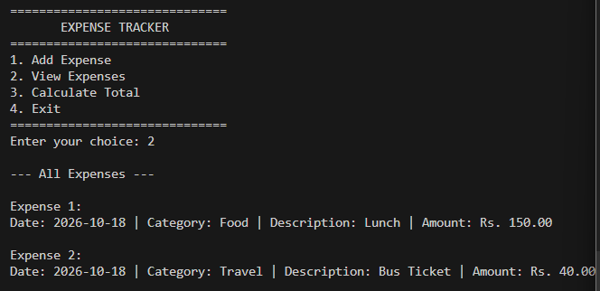
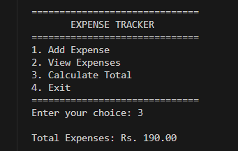
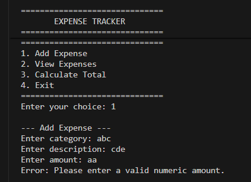
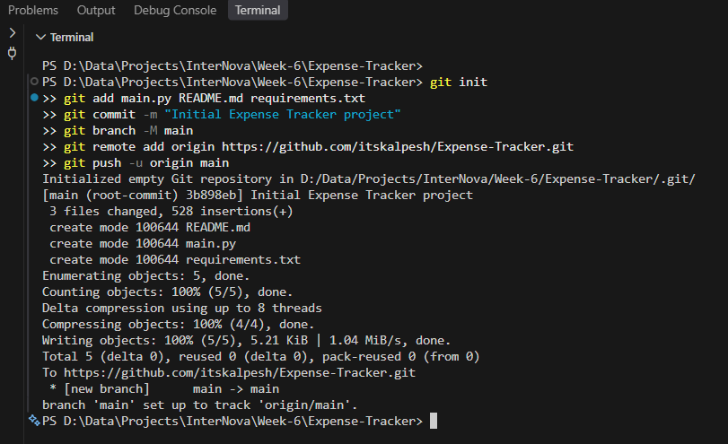
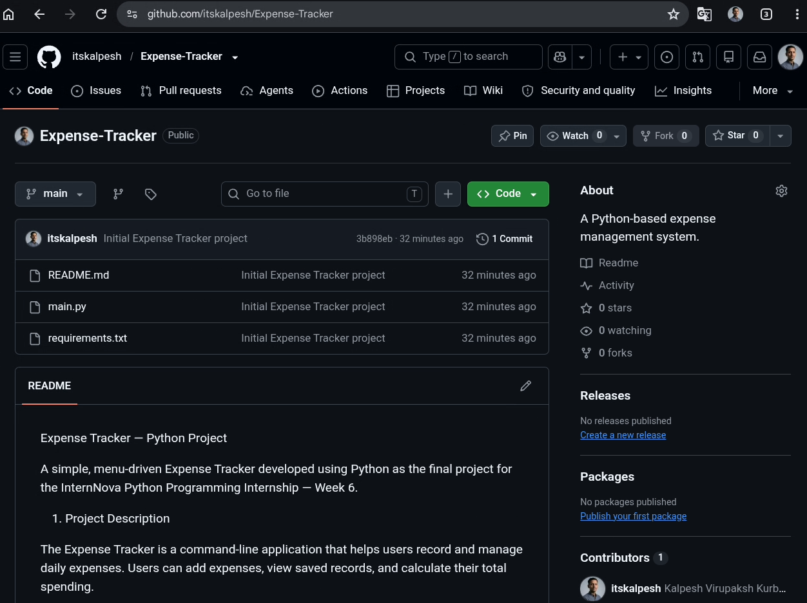

# Expense Tracker Project Report

**Python-Based Expense Management System**

| Project Detail | Information |
|---|---|
| Submitted by | Kalpesh |
| Roll number | INST26PP050039 |
| Course | Python Programming |
| GitHub repository | [itskalpesh/Expense-Tracker](https://github.com/itskalpesh/Expense-Tracker) |

---

## 1. Introduction

Python is a high-level, interpreted programming language widely used in application development, automation, data analysis, and software engineering. Its simple syntax and extensive standard library make it suitable for developing practical applications.

As part of the InternNova Python Programming Internship, the Week 6 assignment focuses on Git, GitHub, repository management, and the development of a final Python project.

The project selected for this assignment is an Expense Tracker, a menu-driven application that helps users record daily expenses, view saved records, and calculate total spending.

The application uses object-oriented programming, CSV file handling, exception handling, input validation, and standard Python libraries. Git and GitHub are used to manage project versions and publish the source code.

This project combines the programming concepts learned during the internship into a practical application.

## 2. Problem Statement

Managing daily expenses manually can be difficult when records are scattered across notebooks or informal notes. Users may find it challenging to maintain accurate records, calculate total spending, and retrieve previously recorded expenses.

A simple computerized expense management system can make this process more organized.

The Expense Tracker addresses this problem by providing a menu-driven interface through which users can add expenses, view existing records, and calculate their total expenditure. The application stores records in a CSV file so that the information remains available after the program is closed.

## 3. Objectives

The main objectives of this project are:

1. To develop a practical application using Python.
2. To record daily expenses with a category, description, amount, and date.
3. To display all saved expense records.
4. To calculate total expenses accurately.
5. To store and retrieve records using CSV file handling.
6. To validate user input and handle common errors.
7. To apply classes, objects, constructors, and encapsulation.
8. To use Python's standard-library modules.
9. To understand Git version control and GitHub repository management.
10. To prepare clear project documentation and a final project report.

## 4. Project Overview

The Expense Tracker is a command-line application that operates through a numbered menu. The user selects an operation, provides the required information, and receives the corresponding result.

The application has two main classes:

- Expense: Represents an individual expense and stores its category, description, amount, and date.
- ExpenseTracker: Manages expense records, file operations, calculations, and menu interactions.

Expense records are stored in `expenses.csv`. When the application starts, it loads previously saved records if the file exists. When a new expense is added successfully, the application saves the updated records.

### 4.1 Main Features

- Add a new expense.
- View all saved expenses.
- Calculate total spending.
- Store records in a CSV file.
- Automatically record the current date for new expenses.
- Reject empty category and description fields.
- Reject zero and negative expense amounts.
- Handle invalid numeric input.
- Handle common file-access errors.
- Provide a menu-driven interface.
- Support source-code management through Git and GitHub.

## 5. Technologies Used

| Technology | Purpose |
|---|---|
| Python 3 | Main programming language |
| `csv` module | Reading and writing expense records |
| `datetime` module | Recording the current date |
| `os` module | Checking whether the data file exists |
| Git | Version control |
| GitHub | Hosting and sharing the repository |
| VS Code or IDLE | Writing and executing the program |
| CSV file | Local expense-data storage |

The project uses Python's standard library and does not require external Python packages.

## 6. Python Concepts Applied

### 6.1 Variables and Data Types

Variables store expense details such as category, description, date, and amount. Strings represent text fields, while floating-point numbers represent expense amounts.

Example:

```python
category = "Food"
description = "Lunch"
amount = float("150")
```

### 6.2 Input and Output

The `input()` function accepts information from the user, while `print()` displays menus, expense records, totals, and error messages.

### 6.3 Type Casting

The `float()` function converts the entered amount into a numeric value so that it can be validated and included in calculations.

### 6.4 Conditional Statements

"if", "elif", and "else" statements are used to process menu choices and validate the entered data.

### 6.5 Loops

A "while" loop keeps the menu running until the user selects the Exit option. A "for" loop displays saved expense records.

### 6.6 Functions and Methods

Methods divide the application into smaller operations, including:

- `add_expense()`
- `view_expenses()`
- `calculate_total()`
- `load_expenses()`
- `save_expenses()`
- `run()`

### 6.7 Object-Oriented Programming

The project uses two classes: "Expense" and "ExpenseTracker". Objects represent individual expenses and the tracker that manages them.

### 6.8 Constructor

The `__init__()` method initializes expense details and tracker data when objects are created.

### 6.9 Encapsulation

The amount is stored using the private attribute `__amount` in the `Expense` class. The `get_amount()` method provides access to the value.

### 6.10 Lists

The "expenses" list stores expense objects in memory. The application iterates over this list to display records and calculate total expenditure.

### 6.11 File Handling

The `open()` function and `with` statement are used to access the CSV file. The `with` statement ensures that the file is properly closed after the operation.

### 6.12 Exception Handling

"try-except" blocks handle invalid numeric input and common file or CSV errors. This prevents several common errors from terminating the application unexpectedly.

### 6.13 Standard-Library Modules

- `csv` supports CSV file operations.
- `datetime` provides the current date.
- `os` checks whether the CSV file exists.

## 7. System Requirements

### Hardware Requirements

- Computer or laptop.
- Keyboard and display.
- Sufficient storage for Python, the source code, and project files.

### Software Requirements

- Python 3.
- Visual Studio Code, IDLE, or another Python-compatible editor.
- Git.
- GitHub account.
- Terminal or command prompt.

An internet connection is required for publishing the repository to GitHub.

## 8. Project Structure

The recommended repository structure is:

```text
Expense-Tracker/
│
├── main.py
├── README.md
├── requirements.txt
├── expenses.csv
│
├── screenshots/
│   ├── add.png
│   ├── git-cmd.png
│   ├── git.png
│   ├── invalid.png
│   ├── menu.png
│   ├── total.png
│   └── view.png
│
└── docs/
    └── Report.md
```

### File Descriptions

- `main.py`: Contains the Python source code.
- `README.md`: Describes the project, features, requirements, and execution steps.
- `requirements.txt`: Documents external dependencies, if any.
- `expenses.csv`: Stores saved expense records and is created when an expense is successfully saved.
- `screenshots/`: Contains screenshots of the application and repository.
- `docs/`: Contains this project report.

The CSV file and screenshot files may not exist until they are generated. The submitted repository should reflect the files actually included.

## 9. Complete Source Code

Save the following program as `main.py`.

```python
# Expense Tracker - Final Python Project
# InternNova Week 6 Assignment

import csv
import datetime
import os

FILE_NAME = "expenses.csv"


# Expense class
class Expense:
    def __init__(self, category, description, amount, date=None):
        self.category = category
        self.description = description
        self.__amount = float(amount)
        self.date = date or str(datetime.date.today())

    def get_amount(self):
        return self.__amount

    def display(self):
        print(
            f"Date: {self.date} | "
            f"Category: {self.category} | "
            f"Description: {self.description} | "
            f"Amount: Rs. {self.__amount:.2f}"
        )


# Expense Tracker class
class ExpenseTracker:
    def __init__(self):
        self.expenses = []
        self.load_expenses()

    # Load saved expenses from CSV
    def load_expenses(self):
        if not os.path.exists(FILE_NAME):
            return

        try:
            with open(
                FILE_NAME, "r", newline="", encoding="utf-8"
            ) as file:
                reader = csv.DictReader(file)

                for row in reader:
                    expense = Expense(
                        row["category"],
                        row["description"],
                        row["amount"],
                        row["date"]
                    )
                    self.expenses.append(expense)

        except (OSError, ValueError, KeyError, csv.Error):
            print("Warning: Could not load some expense data.")

    # Save expenses to CSV
    def save_expenses(self):
        try:
            with open(
                FILE_NAME, "w", newline="", encoding="utf-8"
            ) as file:
                fieldnames = [
                    "date",
                    "category",
                    "description",
                    "amount"
                ]

                writer = csv.DictWriter(
                    file, fieldnames=fieldnames
                )
                writer.writeheader()

                for expense in self.expenses:
                    writer.writerow({
                        "date": expense.date,
                        "category": expense.category,
                        "description": expense.description,
                        "amount": expense.get_amount()
                    })

            return True

        except OSError:
            print("Error: Unable to save expense records.")
            return False

    # Add a new expense
    def add_expense(self):
        print("\n--- Add Expense ---")

        category = input("Enter category: ").strip()
        description = input("Enter description: ").strip()

        if not category or not description:
            print(
                "Error: Category and description cannot be empty."
            )
            return

        try:
            amount = float(input("Enter amount: "))

            if amount <= 0:
                print(
                    "Error: Amount must be greater than zero."
                )
                return

            expense = Expense(category, description, amount)
            self.expenses.append(expense)

            if self.save_expenses():
                print("Expense added successfully!")
            else:
                self.expenses.pop()

        except ValueError:
            print(
                "Error: Please enter a valid numeric amount."
            )

    # Display all expenses
    def view_expenses(self):
        print("\n--- All Expenses ---")

        if not self.expenses:
            print("No expenses found.")
            return

        for index, expense in enumerate(
            self.expenses, start=1
        ):
            print(f"\nExpense {index}:")
            expense.display()

    # Calculate total expenses
    def calculate_total(self):
        total = sum(
            expense.get_amount()
            for expense in self.expenses
        )

        print(f"\nTotal Expenses: Rs. {total:.2f}")

    # Main menu
    def run(self):
        while True:
            print("\n==============================")
            print("       EXPENSE TRACKER")
            print("==============================")
            print("1. Add Expense")
            print("2. View Expenses")
            print("3. Calculate Total")
            print("4. Exit")
            print("==============================")

            choice = input("Enter your choice: ").strip()

            if choice == "1":
                self.add_expense()

            elif choice == "2":
                self.view_expenses()

            elif choice == "3":
                self.calculate_total()

            elif choice == "4":
                print(
                    "Thank you for using Expense Tracker!"
                )
                break

            else:
                print(
                    "Invalid choice. Please select 1 to 4."
                )


# Program execution starts here
if __name__ == "__main__":
    tracker = ExpenseTracker()
    tracker.run()
```

## 10. Program Explanation

### 10.1 Importing Modules

The program imports `csv`, `datetime`, and `os`. These modules provide CSV file operations, date information, and file-existence checking.

### 10.2 Expense Class

The `Expense` class represents a single expense. Its constructor stores the category, description, amount, and date. The `display()` method prints the expense details in a readable format.

### 10.3 ExpenseTracker Class

The `ExpenseTracker` class manages the complete application. It initializes an empty list and loads existing records when possible.

### 10.4 Loading Records

The `load_expenses()` method checks whether `expenses.csv` exists. If it does, the program reads the records using `csv.DictReader` and creates `Expense` objects.

### 10.5 Saving Records

The `save_expenses()` method writes all current expense records to the CSV file using `csv.DictWriter`. It returns a success value so that the application can report whether the save operation succeeded.

### 10.6 Adding Expenses

The `add_expense()` method collects the category, description, and amount. It rejects empty text fields, non-numeric amounts, and amounts that are zero or negative. A valid expense is added to the list and saved.

### 10.7 Viewing Expenses

The `view_expenses()` method displays each expense with its date, category, description, and amount. If there are no records, it displays an appropriate message.

### 10.8 Calculating Total

The `calculate_total()` method uses `sum()` to add the amounts of all loaded expense objects and displays the total to two decimal places.

### 10.9 Main Menu

The `run()` method displays the menu repeatedly and executes the selected operation. The program exits when the user selects option 4.

## 11. Installation and Execution

Follow these steps to run the application.

### Step 1: Install Python

Install Python 3 and verify the installation:

```powershell
python --version
```

On some systems, use:

```powershell
python3 --version
```

### Step 2: Open the Project Folder

Open a terminal in the directory containing `main.py`.

### Step 3: Execute the Program

```powershell
python main.py
```

Alternatively:

```powershell
python3 main.py
```

### Step 4: Select an Operation

Choose an option from 1 to 4 and follow the prompts displayed in the terminal.

### Step 5: Verify Saved Data

After successfully adding an expense, check the generated `expenses.csv` file in the project directory.

## 12. Sample Output

The following examples illustrate the expected interaction. The actual output depends on the records saved in the CSV file.

### 12.1 Main Menu

```text
==============================
       EXPENSE TRACKER
==============================
1. Add Expense
2. View Expenses
3. Calculate Total
4. Exit
==============================
Enter your choice: 1
```



*Figure 1. Main menu displayed when the application starts.*

### 12.2 Adding an Expense

```text
--- Add Expense ---
Enter category: Food
Enter description: Lunch
Enter amount: 150
Expense added successfully!
```

### 12.3 Adding Another Expense

```text
--- Add Expense ---
Enter category: Travel
Enter description: Bus Ticket
Enter amount: 40
Expense added successfully!
```



*Figure 2. Adding Food and Travel expenses successfully.*

### 12.4 Viewing Expenses

```text
--- All Expenses ---

Expense 1:
Date: 2026-10-18 | Category: Food | Description: Lunch | Amount: Rs. 150.00

Expense 2:
Date: 2026-10-18 | Category: Travel | Description: Bus Ticket | Amount: Rs. 40.00
```

The displayed date is illustrative. New records use the current date.



*Figure 3. Viewing the saved expense records.*

### 12.5 Calculating Total

```text
Total Expenses: Rs. 190.00
```



*Figure 4. Total spending calculated from the saved records.*

### 12.6 Invalid Numeric Input

```text
--- Add Expense ---
Enter category: Shopping
Enter description: Notebook
Enter amount: abc
Error: Please enter a valid numeric amount.
```



*Figure 5. The application rejects a non-numeric amount.*

### 12.7 Zero Amount

```text
--- Add Expense ---
Enter category: Food
Enter description: Snacks
Enter amount: 0
Error: Amount must be greater than zero.
```

### 12.8 Invalid Menu Choice

```text
Enter your choice: 9
Invalid choice. Please select 1 to 4.
```

### 12.9 Exiting the Application

```text
Enter your choice: 4
Thank you for using Expense Tracker!
```

## 13. CSV Data Storage

The application stores records in `expenses.csv`.

An example file containing two sample expenses is shown below:

```csv
date,category,description,amount
2026-10-18,Food,Lunch,150.0
2026-10-18,Travel,Bus Ticket,40.0
```

The CSV file uses a header row followed by one row per expense. When the application restarts, it reads the saved records and makes them available for viewing and calculating the total.

Use sample data for demonstrations and avoid uploading personal financial records.

## 14. Project Workflow

The program follows this workflow:

1. Start the application.
2. Initialize the expense tracker.
3. Load saved records from the CSV file, if available.
4. Display the main menu.
5. Accept the user's choice.
6. Execute the selected operation.
7. Save records when a new expense is added successfully.
8. Return to the menu.
9. Exit when the user selects option 4.

### Workflow Diagram

```text
             START
               |
               v
     Initialize Tracker
               |
               v
      Load Saved Records
               |
               v
        Display Menu
               |
               v
       Enter User Choice
               |
       +-------+-------+
       |       |       |
       v       v       v
      Add     View   Calculate
    Expense  Records   Total
       |       |       |
       v       v       v
    Validate Display Display
     Input   Records  Total
       |
       v
    Save CSV
       |
       +-------+
               |
               v
        Return to Menu
               |
               v
              EXIT
```

## 15. Testing and Validation

Testing is required to verify that the application behaves correctly with valid and invalid input.

| No. | Test case | Expected result |
|---:|---|---|
| 1 | Start the application | Main menu appears |
| 2 | Add a valid expense | Record is saved successfully |
| 3 | View saved expenses | Records are displayed |
| 4 | Calculate the total | Total spending is displayed |
| 5 | Enter text instead of an amount | Numeric-input error appears |
| 6 | Enter zero as the amount | Amount is rejected |
| 7 | Enter a negative amount | Amount is rejected |
| 8 | Leave category empty | Input is rejected |
| 9 | Leave description empty | Input is rejected |
| 10 | Enter an invalid menu option | Invalid-choice message appears |
| 11 | Restart after saving an expense | Saved records are loaded |
| 12 | Exit the application | Program terminates |

The expected results above should be verified by executing the program. Only mark a test as passed after confirming the actual result.

## 16. Git and GitHub Implementation

Git is a version control system used to record changes to project files. GitHub hosts Git repositories online and allows source code to be shared.

### 16.1 Configure Git

Install Git and configure the author information:

```powershell
git config --global user.name "Kalpesh"
git config --global user.email "YOUR_GITHUB_EMAIL"
```

Replace "YOUR_GITHUB_EMAIL" with your own email address.

Verify the configuration:

```powershell
git config --global --list
```

### 16.2 Initialize the Repository

Open the terminal in the project folder:

```powershell
git init
git status
```

The `git init` command initializes the local repository. The `git status` command displays the current state of the working tree.

### 16.3 Stage and Commit Files

After creating the source code and documentation, stage and commit the files:

```powershell
git add main.py README.md requirements.txt
git commit -m "Initial Expense Tracker project"
```

The `git add` command stages selected files. The `git commit` command records the staged changes.

If you have added the report and screenshots, stage those files as well.

### 16.4 Create the GitHub Repository

1. Sign in to GitHub.
2. Select New repository.
3. Enter "Expense-Tracker" as the repository name.
4. Add a project description.
5. Select the required visibility.
6. Create the repository.

If you already have the local project and README, creating an empty repository avoids unnecessary conflicts during the first push.

### 16.5 Connect the Local Repository

Replace "YOUR_USERNAME" with your actual GitHub username:

```powershell
git branch -M main
git remote add origin https://github.com/YOUR_USERNAME/Expense-Tracker.git
git remote -v
git push -u origin main
```



*Figure 6. Initializing the local repository and pushing the project to GitHub.*

These commands rename the branch to "main", connect the local repository to GitHub, verify the remote URL, and upload the committed files.

If the `origin` remote already exists, verify it using `git remote -v` rather than adding it again.

### 16.6 Verify the Upload

Open the GitHub repository page and check that the expected files are visible. Confirm that the source code, README, and other required deliverables have been uploaded.

Never upload passwords, access tokens, or confidential financial information.



*Figure 7. The Expense Tracker repository on GitHub.*

## 17. Repository Management and README

The README file helps users understand the project without inspecting every line of code.

The project's `README.md` should include:

- Project title and description.
- Project objectives and features.
- Technologies used.
- Python concepts applied.
- Project folder structure.
- Prerequisites and installation steps.
- Instructions to run the application.
- Usage examples and sample output.
- Testing information.
- Limitations and future improvements.
- Author and repository information.

### Dependency Information

The application uses Python's standard-library modules, so it does not require external packages. The `requirements.txt` file can be empty, with this information explained in the README.

### Updating the Repository

After modifying project files, review and upload the changes:

```powershell
git status
git add main.py README.md requirements.txt
git commit -m "Update Expense Tracker project"
git push
```

Include any additional files that have changed. Before using `git add .`, check that confidential or personal data will not be included.

## 18. Challenges and Solutions

### 18.1 Invalid User Input

Challenge: Users may enter letters instead of numeric amounts or leave required fields empty.

Solution: The program uses "try-except" for invalid numeric input and conditional checks for empty fields and non-positive amounts.

### 18.2 Persistent Data Storage

Challenge: Expense records must remain available after the application closes.

Solution: The program stores records in a CSV file and loads the records when the application starts.

### 18.3 File Handling Errors

Challenge: The CSV file may not exist initially, or file operations may fail.

Solution: The program checks whether the file exists and handles common file-access and CSV errors.

### 18.4 Program Organization

Challenge: A single long block of code would be difficult to understand and maintain.

Solution: The program separates responsibilities into classes and methods.

### 18.5 Version Control

Challenge: Changes need to be tracked and the project must be shared.

Solution: Git is used to record project changes, while GitHub provides online repository hosting.

## 19. Learning Outcomes

Through this project, the following practical skills can be developed:

1. Writing a menu-driven Python application.
2. Applying variables, data types, conditions, loops, and type casting.
3. Designing classes and objects.
4. Using constructors and encapsulation.
5. Reading and writing CSV files.
6. Handling invalid input and file errors.
7. Using Python standard-library modules.
8. Testing application behavior.
9. Organizing source code and documentation.
10. Using Git commands and GitHub repositories.
11. Preparing a technical project report.

The project demonstrates basic object-oriented programming, including classes, objects, constructors, and encapsulation. It does not currently implement inheritance or polymorphism, so these concepts should not be claimed as implemented features.

## 20. Project Limitations

The current version has several limitations:

- It uses a command-line interface rather than a graphical interface.
- It does not provide monthly or yearly reports.
- It does not provide category-wise expense summaries.
- It does not support budget limits or alerts.
- It stores data locally in a CSV file.
- It does not include user accounts or multi-user access.
- It does not provide advanced backup or data-recovery functionality.

## 21. Future Improvements

The application can be enhanced in the following ways:

1. Monthly Reports: Generate expense summaries for selected months and years.
2. Category Analysis: Calculate totals for Food, Travel, Shopping, Education, and other categories.
3. Budget Management: Set monthly budgets and display warnings when spending approaches the limit.
4. Search and Filtering: Search records by date, category, description, or amount.
5. Graphical Interface: Create a user-friendly interface using a Python GUI framework.
6. Data Visualization: Display spending trends through charts and graphs.
7. Report Export: Export summaries to PDF or Excel.
8. Backup Support: Add backup and recovery functionality.
9. Expanded OOP Design: Introduce additional classes and inheritance when they provide a clear benefit.

## 22. Final Submission Checklist

Before submitting the assignment, verify the following items.

### Project Implementation

- [ ] `main.py` contains the complete source code.
- [ ] The program starts successfully.
- [ ] Adding expenses works correctly.
- [ ] Viewing records works correctly.
- [ ] Total calculation is correct.
- [ ] CSV saving and loading work correctly.
- [ ] Invalid input is handled appropriately.

### Repository

- [ ] Git is installed and configured.
- [ ] The local repository is initialized.
- [ ] Project files are committed.
- [ ] The GitHub repository is created.
- [ ] The project has been pushed to GitHub.
- [ ] The repository contains the required files.
- [ ] No confidential data is included.

### Documentation

- [ ] `README.md` is complete.
- [ ] Dependency information is accurate.
- [ ] Screenshots show actual program output.
- [ ] The report includes all required sections.
- [ ] The student and internship details are correct.
- [ ] The final report has been exported to PDF if required.
- [ ] The GitHub repository URL is correct.

## 23. Conclusion

The Expense Tracker project demonstrates the practical application of Python programming concepts in a simple expense management system. It allows users to add expenses, view saved records, calculate total expenditure, and maintain records through CSV file handling.

The project applies classes, objects, constructors, encapsulation, lists, loops, conditions, input validation, exception handling, and standard-library modules. It also introduces version control through Git and source-code hosting through GitHub.

Developing this application provides experience in organizing code, managing local data, testing functionality, handling common errors, and documenting a software project.

The project can be extended in the future with graphical interfaces, budget management, monthly reports, category-wise analysis, and data visualization.

Overall, the Expense Tracker provides a practical foundation for further Python application development and demonstrates the core objectives of the Week 6 internship assignment.

---

## 24. Student and Repository Details

| Project detail | Information |
|---|---|
| Student name | Kalpesh |
| Roll number | INST26PP050039 |
| Internship organization | InternNova |
| Internship domain | Python Programming |
| Assignment | Week 6: Git, GitHub, and Final Python Project |
| Project title | Expense Tracker: A Python-Based Expense Management System |
| GitHub repository | [itskalpesh/Expense-Tracker](https://github.com/itskalpesh/Expense-Tracker) |